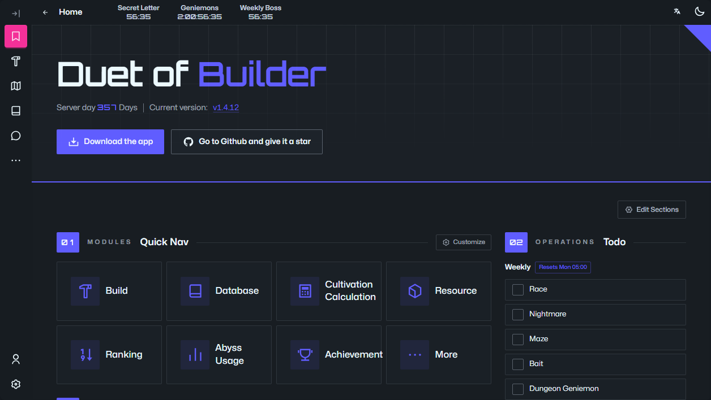

English | [简体中文](./README.zh-CN.md)

# Duet Night Abyss Builder (DNA Builder)

<p align="center">
  <a href="https://dna-builder.cn/"></a>
  <a href="https://github.com/pa001024/dna-builder/actions/workflows/alpha.yml"></a>
  <a href="https://github.com/pa001024/dna-builder/stargazers"></a>
  <a href="https://github.com/pa001024/dna-builder"></a>
  
</p>

<p align="center">
  <strong>DNA Builder</strong> (DOB for short) is an all-in-one toolkit for <b>Duet Night Abyss (二重螺旋)</b>, offering <b>data lookup, character building, progression analysis and damage calculation</b> to help players optimize their builds efficiently.
</p>

## Access

### 🌐 Web (PWA supported)

Open it directly in your browser, or install it as a PWA app with offline support.

| Mirror                        | Link                                                                 |
| ----------------------------- | -------------------------------------------------------------------- |
| **China server** (recommended) | [https://dna-builder.cn/](https://dna-builder.cn/)                   |
| EdgeOne CDN node              | [https://dna-builder.edgeone.dev/](https://dna-builder.edgeone.dev/) |
| Vercel global node            | [https://dna-builder.vercel.app/](https://dna-builder.vercel.app/)   |

### 🖥️ Desktop (recommended experience)

| Method            | Command / Link                                                                                     |
| ----------------- | -------------------------------------------------------------------------------------------------- |
| **winget**        | `winget install pa001024.dna-builder`                                                              |
| **Microsoft Store** | [https://apps.microsoft.com/detail/9nk8zw43shb1](https://apps.microsoft.com/detail/9nk8zw43shb1) |
| **GitHub Releases** | [Download the latest release](https://github.com/pa001024/dna-builder/releases/latest)           |

[Quark Pan download](https://pan.quark.cn/s/1419bbc8aa2d)

> **Prerequisite**: the desktop build depends on [Microsoft Edge WebView2](https://developer.microsoft.com/microsoft-edge/webview2/), which is usually pre-installed on Windows 10/11. If missing, download it from there.



## Features

### 🎯 Builds & Calculation

| Feature              | Description                                              |
| -------------------- | -------------------------------------------------------- |
| **Character builds** | Visual setup of characters, weapons, MODs and BUFFs      |
| **Auto build**       | One-click search for high-value combinations             |
| **Damage calc**      | Real-time expected skill and weapon damage               |
| **Target function**  | Custom-expression optimization supported                 |

### 📦 Data Management

| Feature       | Description                              |
| ------------- | ---------------------------------------- |
| **Inventory** | Record and filter owned weapons and MODs |
| **Pinyin search** | Quickly find characters, weapons and MODs |

### 🎮 Simulators

| Feature          | Description                          |
| ---------------- | ------------------------------------ |
| **Fishing sim**  | Built-in fish and fishing-spot data  |
| **Secret-letter sim** | Built-in secret-letter data and sim flow |
| **Achievements** | Record and track achievement progress |

### 🤖 Integrations

| Feature        | Description                                              |
| -------------- | -------------------------------------------------------- |
| **MCP Server** | AI-tool integration, callable by third-party clients     |

## Tech Stack

### Frontend

| Tech                                               | Purpose                                            |
| -------------------------------------------------- | -------------------------------------------------- |
| **Vue 3** + **TypeScript**                         | Core framework, Composition API + strict type safety |
| **Vite 7**                                         | Build tool and dev server                           |
| **Tailwind CSS v4** + **daisyUI v5** + **reka-ui** | Styling framework and UI component libraries        |
| **Pinia** + **Vue Router**                         | State management and routing                        |
| **i18next**                                        | Internationalization (multi-language support)       |
| **Vitest** + **Biome**                             | Unit testing and code quality tooling               |

### Desktop App

| Tech                           | Purpose                                                        |
| ------------------------------ | -------------------------------------------------------------- |
| **Tauri 2** (Rust + WebView2) | Cross-platform desktop shell packaging the web app as a native desktop app |

### Server (optional, for data sync)

| Tech                         | Purpose              |
| ---------------------------- | -------------------- |
| **Bun** + **Elysia**         | Runtime and web framework |
| **SQLite** + **Drizzle ORM** | Database and ORM     |
| **GraphQL Yoga**             | GraphQL API gateway  |

## SDK

Game-data and damage-calculation SDKs, pick your language (aligned calculation results):

| Language        | Package                                                            | Description                                                              | Docs                                     |
| --------------- | ------------------------------------------------------------------ | ------------------------------------------------------------------------ | ---------------------------------------- |
| Node.js / Bun   | [`dna-builder-data`](https://www.npmjs.com/package/dna-builder-data) | Game data + character builds / damage calculation, also usable as MCP Server | [src/data/README.md](src/data/README.md) |
| Python          | `dna-builder-sdk`                                                  | Public backend read API + data packs / on-demand loading + pure expression evaluation | [sdk/python/README.md](sdk/python/README.md) |
| Go              | `dob`                                                              | Same capabilities as the Python SDK: public backend read API + data loading + calculation | [sdk/go](sdk/go/README.md) |

### Node.js / Bun

```bash
npm install dna-builder-data
```

```typescript
import { CharBuild, LeveledChar, LeveledWeapon } from "dna-builder-data"

const build = new CharBuild({
    char: new LeveledChar("黎瑟", 80),
    melee: new LeveledWeapon("铸铁者"),
    targetFunction: "DPS",
})
const damage = build.calculate()
```

MCP Server (for AI tools):

```bash
npx -y dna-builder-data
```

### Python / Go

See their respective READMEs: [sdk/python/README.md](sdk/python/README.md), [sdk/go](sdk/go).

## Languages

Currently supported (including partial data translations):

- Chinese (Simplified / Traditional)
- English
- 日本語
- 한국어

Translation improvements are welcome.

## Development

### Requirements

- Node.js (20+ recommended)
- `pnpm` (this project uses `pnpm`)
- `bun` (for the server and tooling scripts)
- Rust toolchain (for Tauri development)

### Frontend

```bash
# Install dependencies
pnpm install

# Local dev (default http://localhost:1420/)
pnpm dev

# Lint (Biome + vue-tsc)
pnpm lint

# Unit tests
pnpm test

# Format code
pnpm format
```

### Desktop App (Tauri)

```bash
pnpm tauri dev
pnpm tauri build
```

### Server (Bun + Elysia)

```bash
cd server
bun install

# Dev mode (with migrations)
bun run dev

# Generate migrations
bun run gen

# Run migrations
bun run mig
```

## Support the Author

If this project helps you, consider supporting it:

- Afdian: [https://afdian.com/a/pa001024](https://afdian.com/a/pa001024)
- Microsoft Store purchase: [https://apps.microsoft.com/detail/9nk8zw43shb1](https://apps.microsoft.com/detail/9nk8zw43shb1)

## Contributing

Issues and Pull Requests are welcome.

## License

MIT License

## Contact

For questions or suggestions, please open an Issue in the GitHub repo.

## Star History

<a href="https://www.star-history.com/?repos=pa001024%2Fdna-builder&type=date&legend=top-left">
 <picture>
   <source media="(prefers-color-scheme: dark)" srcset="https://api.star-history.com/chart?repos=pa001024/dna-builder&type=date&theme=dark&legend=top-left&sealed_token=LXOoUzbm3HM8Nc2DoiJ6ovedllz2zWB3lbr3N2Kl6T46JCogtephnQYUUmRjLGe0paf0Mhk24ZpIuH2O0V-fXHBvFIHYkYPTPIeeOnQHZUJNK_tQt3fpF1U8aBECd3Ih2jssp3KuoSaAJpzHfC-0e2-AZ_thGWrVPvBMTYAyNFCFs4i2AuJiXKEss5qh" />
   <source media="(prefers-color-scheme: light)" srcset="https://api.star-history.com/chart?repos=pa001024/dna-builder&type=date&legend=top-left&sealed_token=LXOoUzbm3HM8Nc2DoiJ6ovedllz2zWB3lbr3N2Kl6T46JCogtephnQYUUmRjLGe0paf0Mhk24ZpIuH2O0V-fXHBvFIHYkYPTPIeeOnQHZUJNK_tQt3fpF1U8aBECd3Ih2jssp3KuoSaAJpzHfC-0e2-AZ_thGWrVPvBMTYAyNFCFs4i2AuJiXKEss5qh" />
   
 </picture>
</a>
