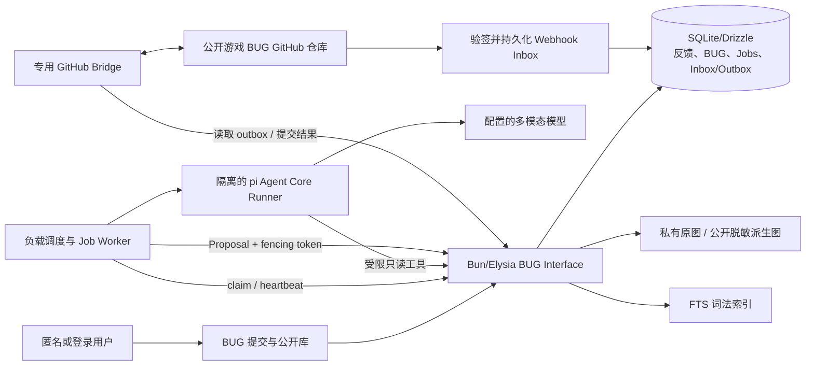

# 游戏 BUG 收集、AI 归并与 GitHub 双向协作 — Spec

| 项目 | 值 |
|---|---|
| 状态 | Final Spec — 产品设计，实现前以此为准 |
| Spec 版本 | 1.0.0 |
| 更新日期 | 2026-11-17，Asia/Shanghai |
| 所属项目 | DNA Builder |
| 收集对象 | 游戏 BUG；默认按《二重螺旋》单游戏设计，不收集 DNA Builder 自身软件 BUG |
| 调研报告 | `.docs/game-bug-intake-research-2026-11-16.md` |

本文中的"必须"是实现验收条件；"建议默认值"是设计参数，实施时按实测调整。

## 1. 已确认决策

1. 收集**游戏 BUG**，BUG 库公开，用户公开参与。
2. 支持匿名提交，也支持登录账号参与。
3. AI 处理后自动入库、自动由 bot 提交 GitHub，**没有人工审核前置步骤**。
4. 双向互动包含：站内评论同步 GitHub、GitHub 评论回流站内、关闭／重开状态同步。
5. 输入允许自由文字、图片或二者组合；AI 负责总结、判重、拆分等处理。
6. 后端使用 pi harness；按负载选择即时启动或周期性处理。
7. BUG 库支持分类、严重程度等筛选，再次反馈、投票，投票与严重程度共同决定排序。
8. **投票不开放匿名，投票和撤票必须登录**；匿名回执不是投票凭据。
9. 有关联的 BUG／Issue 可以互相提及。
10. 修复情况通过 tag 跟踪；本站 tag 与 GitHub Issue labels 双向同步且语义一致。

自动安全校验、脱敏、垃圾内容过滤和证据不足时追问，不属于人工审核。无法安全公开的素材可以自动留在私有证据区；不能为了"免审核"泄露隐私，也不能把普通提交全部转入人工队列。

## 2. 产品目标、范围与非目标

### 2.1 目标

- 不要求用户写标准 BUG 模板。用户说"这个界面卡住了"并附图也可以开始反馈。
- 一个反馈可拆成多个 BUG；多个反馈可聚合为一个 BUG；每个结论都能回到原始证据。
- 匿名用户不被账号注册挡住，登录用户获得跨设备历史、订阅和投票能力。
- 公开库展示结构化、脱敏的 BUG，而不是把所有原始图片直接公开。
- 自动生成 GitHub Issue，并让社区和 GitHub 参与者看到同一条讨论及处理状态。
- 系统故障、模型超时、Webhook 丢失或重投递，不导致反馈丢失、重复 Issue 或同步回环。

### 2.2 完整目标范围

提交与回执、图片处理、AI 管线、负载调度、BUG 库、筛选排序、投票、再次反馈、匿名权限、通知、GitHub 创建与双向评论／状态同步、纠错、运维、故障恢复和测试均在本文范围内。

### 2.3 非目标

- 自动修改游戏代码、提交 PR、执行用户提供的命令或运行未知附件。
- 把截图中的描述当作已复现事实，或承诺官方一定修复。
- 把 GitHub reactions 当本站投票，或要求用户关联 GitHub 账号。
- 通过游戏账号／UID 验证真实玩家身份，或自动读取用户电脑日志。
- 收集任意二进制、视频、压缩包；只接受文字和受支持图片。
- 自动导入目标仓库全部历史 Issue；仅同步已映射 Issue，历史导入作为显式配置任务。
- 依赖 GitHub preview 能力（原生 duplicate state_reason、原生 workflow status）；统一走 Issue label + 评论兼容路径。

## 3. 术语与核心不变量

| 术语 | 含义 |
|---|---|
| Submission | 一次原始反馈及后续追加版本，保留作者实际提供的内容 |
| Part | AI 从一次反馈中提取的可独立判断／处理的问题单元 |
| Bug | 公开库中的规范 BUG，可能汇集多个反馈，不代表已经复现 |
| Occurrence | Part 与 Bug 的证据关联；同一个人重复发帖不等于多个受影响用户 |
| Feedback | 在已有 Bug 上追加的新文字、图片、版本信息或"仍有／已无此问题"报告 |
| DiscussionEntry | 本站或 GitHub 的评论；来源和作者保留，不冒充另一平台账号 |
| Proposal | pi 产生、尚未经过确定性校验与事务提交的结构化建议 |
| Job | 可恢复、带租约的后台任务；即时与周期模式使用同一种任务 |
| IssueLink | Bug 与 GitHub Issue 的持久映射，不只保存可变的 Issue number |
| BugRelation | 两个规范 Bug 之间带类型、方向、来源和证据的站内关联；关联不等于归并 |
| TrackingTag | 用稳定 `tagKey` 表示的领域标签，界面译名和 GitHub label 名只是展示／映射 |
| FixStage | 由修复跟踪标签表达的维护进度声明，与 Issue open/closed、实际发布版本和验证证据分别记录 |
| TagRegistry | 标签语义字典及互斥组、权限、GitHub label 绑定；这里的 tag 是 Issue label，不是 Git tag |

必须成立的不变量：

1. **先持久化，再回复接受成功**。已返回回执的反馈不依赖内存队列生存。
2. 原始内容逻辑上追加版本，不被 AI 改写；依法删除采用 tombstone、对象清除和派生数据清理。
3. AI 只提出建议。提交数据库、权限、配额、排名、GitHub 写入由确定性 Implementation 执行。
4. 用户原话、AI 推断、维护者确认、GitHub 处理状态分别标记来源。
5. 图片 SHA 相同只证明文件相同，不能单独证明是同一个 BUG。
6. votes 不修改 severity；一个高票外观问题不能挤掉低票严重问题。
7. 一条本地业务事件可以被重复传输，但只产生一次本地业务效果；不宣称 GitHub POST 原生支持 exactly-once。
8. 对同一规范 Bug、同一目标仓库，最多有一个当前主 IssueLink。
9. 普通评论、截图文字和 `@dob-bot` 字样均是数据，不进入代码执行链。
10. 私有来源不会出现在公开搜索、数量统计、相似 BUG 推荐或 GitHub 导出中。
11. 疑似重复／关联关系不会自动合并票数、移动证据或关闭 Issue；明确重复另走归并策略。
12. 同一个 `tagKey` 在两端表达同一含义；修复标签不能被普通自由文本、票数或 AI 猜测提升为"官方已修复"。

## 4. 用户体验与页面

### 4.1 提交

1. 在 `/bugs/new` 输入任意文字，粘贴／拖拽／选择图片。文字可以为空，但必须有至少一张有效图片。
2. 可选填写区服、平台、游戏版本、频率；字段缺失不会拒绝提交。
3. 展示清楚的告知：AI 处理、脱敏摘要公开、允许公开内容自动同步公开 GitHub；原始截图不直接公开。
4. 用户可以把某段补充或某张图标记为私密，此内容不外发。
5. 可先展示相似 BUG，用户可选"我也遇到了"，也可继续新提交；相似推荐不拦截提交。
6. 点击提交后立即取得回执，显示"已收到／排队／正在整理／已归入 N 个 BUG／需要补充／处理失败"等真实状态。
7. AI 成功提交事务后，展示结构化结果及"已创建 Issue／待同步／同步异常"，不能在 GitHub 成功前显示"已同步"。

提交 UI 不设置人工审核状态。自动过滤后的结果应给出可理解原因和继续提交途径，不静默吞掉。

### 4.2 BUG 列表 `/bugs`

- 展示标题、分类、平台、区服、已知影响版本、严重程度来源、状态、修复跟踪标签及来源、有效票数、受影响报告人数、最近活动、GitHub 链接。
- 筛选：关键词、主分类、多标签、严重程度、状态、修复阶段、关联类型、平台、区服、游戏版本／版本范围、时间、已同步／同步异常。
- 登录后增加"我提交／我投票／我关注"；匿名回执不用于遍历其他人的反馈。
- 排序：综合优先级（默认）、严重程度、票数、最近反馈、创建时间。
- 默认只显示公开、未结束的规范 Bug；合并项转向规范记录，已关闭／重复项可显式筛选查看。
- URL 保存非敏感筛选条件。

不同筛选维度取 AND，同一维度多选取 OR；多标签默认 `tagsMatch=any`，可显式选 `all`。未知平台／区服／版本只在选择"未知"时命中该维度。游戏版本范围按配置中的发布顺序／版本 ID 比较，不按字符串排序，也不假定游戏版本符合 SemVer；无法比较的自报版本保留原话，不自动命中范围查询。

### 4.3 BUG 详情 `/bugs/:bugId`

主要区域：

1. 摘要：问题是什么、实际行为、期望行为、复现步骤／缺失信息、影响环境。
2. 证据：可公开的脱敏图、原文摘录和对应来源；非公开证据不暴露链接或数量。
3. 状态：AI 整理／未复现、维护者确认、GitHub 已关闭、已发布修复等不能混为一谈。
4. 社区：投票、"我也遇到／此版本未遇到"、自由补充文字与图片、讨论时间线。
5. 关联：疑似重复、相关但不同、被合并记录、GitHub 主 Issue；展示方向、依据及两端链接。
6. 同步：本站与 GitHub 来源标记、同步中／成功／失败、最后对账时间。
7. 修复跟踪：当前 `fix:*` 标签、变更时间线、标注者、已知修复版本和验证证据；"维护者标注"与"证据充分"分开展示。

GitHub 的 `closed + completed` 默认展示"协作 Issue 已关闭，待验证"，**不能直接显示"游戏官方已修复并上线"**。修复版本必须有独立证据或维护者记录。

### 4.4 回执与我的反馈

- `/bugs/submissions/:submissionId`：登录作者或持有回执 token 可查看原始反馈、处理过程摘要和关联 Bug。
- `/bugs/mine`：登录用户跨设备查看历史、投票和订阅。
- 匿名回执 token 在提交成功后一次性展示，浏览器 localStorage 保存；丢失后无法证明原始反馈所有权。
- 回执 token 不放 URL、埋点、Referer 或公开 Issue。

### 4.5 管理与纠错

建议路由：`/admin/bugs`、`/admin/bug-jobs`、`/admin/bug-sync`。管理人员可以纠错分类、严重程度、拆分、合并、解除误合并、屏蔽垃圾内容、重跑和处理同步异常。

这些是**事后纠错／维护工具，不是提交发布的人工审批关卡**。沿用当前后台 Ledger 设计，不将此业务直接套用现有通用评论表或代码修复 bot。

## 5. 匿名身份、权限与反滥用

### 5.1 匿名回执

- 匿名提交成功后返回一个随机 `receiptToken`（一次性展示，浏览器 localStorage 保存）。凭此 token 可查看自己反馈的处理状态、追加补充、在关联 Bug 下评论。
- token 是高熵随机字符串，服务端存其 SHA-256 摘要；泄露不暴露其他用户信息，丢失后无法找回。
- token 只授权对应 Submission 及其关联 Bug 的读取和补充，不授予编辑、投票、状态修改权限。
- 幂等提交：客户端生成随机幂等键，同 key 重试返回同一回执，不重复创建反馈。

### 5.2 权限矩阵

| 行为 | 游客 | 匿名回执持有 | 登录用户 | 维护者 | 集成执行身份 |
|---|---|---|---|---|---|
| 读取公开库与讨论 | 是 | 是 | 是 | 是 | 按任务需要 |
| 新提交 | 限流后可 | 可 | 可 | 可 | 不冒充用户 |
| 读取原始私有反馈 | 否 | 仅自己的 | 仅自己的 | 审计后按权限 | 当前 job 的最小范围 |
| 再次反馈／评论 | 可新建匿名反馈 | 关联 Bug 内可 | 可 | 可 | 来源注明 |
| 投票／撤票 | 否，已确认禁止 | 否，已确认禁止 | 每规范 Bug 一票 | 同规则 | 否 |
| 改 severity／分类 | 否 | 否 | 可提异议 | 可纠错 | 仅确定性策略允许字段 |
| 关闭／强制重开 | 否 | 否 | 可提供新证据 | 可 | 按状态同步策略 |
| 合并／解除误合并 | 否 | 否 | 可反馈错误 | 可 | 仅满足自动策略时可合并 |
| 设置关联／跟踪标签 | 否 | 只可提供关联／修复证据 | 可提供建议，不能改维护标签 | 可，版本校验并审计 | 按工具外的确定性权限／策略 |
| GitHub 写入 | 否 | 否 | 经产品动作入 outbox | 经动作入 outbox | 专用 GitHub App |

使用现有 `resolveUser` 解析登录；高权限操作重新核对服务端角色，不只相信长期 JWT 中旧角色。集成身份与用户 JWT 分离，限定任务、仓库、Interface 和有效期。

### 5.3 限流建议默认值

- 匿名新提交：按 IP／指纹限流，建议 3 次／10 分钟、20 次／日；登录用户 10 次／10 分钟、100 次／日。
- 评论／补充：10 次／10 分钟；单 Bug 的相同内容重试不重复入库。
- 投票动作：登录用户 30 次／分钟；重复设置同一状态是幂等操作。
- 限额并非身份验证。异常流量才增加挑战验证，并提供明确错误与重试时间。
- 新接收反馈超过全局存储／待处理上限时返回 429 或 503 和 `Retry-After`，不返回假回执。
- 垃圾内容、辱骂、人肉信息和无关广告由自动策略隔离；用户可提交异议，但正常反馈无需人工放行。

## 6. Module 与执行架构

推荐实现为当前后端上的业务 Module，加独立 pi Runner 和独立 GitHub Bridge。Interface 只暴露业务动作，不把数据库、模型工具调用或 GitHub 任意请求暴露给调用方。



### 6.1 建议 Interface

```ts
type BugIntakeInterface = {
    acceptSubmission(input: SubmissionInput, actor: Actor): Promise<SubmissionReceipt>
    addFeedback(bugId: string, input: FeedbackInput, actor: Actor): Promise<FeedbackReceipt>
    setVote(bugId: string, active: boolean, actor: LoggedInActor): Promise<VoteResult>
    listBugs(query: BugQuery, actor: ReadActor): Promise<BugPage>
    getBug(bugId: string, actor: ReadActor): Promise<BugDetail>
}
```

本代码块描述 Interface，不是已存在代码。worker 内部另有 claim、heartbeat、commitProposal 和 outbox/inbox 动作；集成身份不能调用任意 SQL 或任意外部 URL。

维护入口另有 `setRelation` 和 `setTrackingTags`：调用方只提交目标、期望版本、领域标签／关系与证据，Module 的 Implementation 负责关联投影、标签互斥、权限、事务、outbox 和对账；调用方不直接操作 GitHub label 名或评论 marker。

### 6.2 存储与运行时

- 业务记录、Jobs、Inbox、Outbox 和本地业务事件在**同一个事务数据库**，避免跨库提交假原子性。
- 延续当前 Bun SQLite + Drizzle，建议启用 WAL、外键和有界 `busy_timeout`；已接受反馈要求适当持久化，不能仅为速度默认选会丢已提交事务的策略。
- SQLite WAL 是同主机方案，不把数据库文件放共享网络盘供多主机 worker 直接写。
- API 拥有持久化事务；独立 worker 经内部认证 Interface 领取任务、心跳和提交结果。pi 子进程不持有数据库路径和 GitHub 凭据。
- 多实例需要一个全局并发／额度分配机制；不能每个进程各自认为"并发上限 2"。跨主机业务数据库需求出现时再评估 Postgres 迁移。
- 所有网络／AI 调用在 SQL 事务外；事务内只做校验、短查询和写入。

### 6.3 pi 的职责与装配契约

采用 [pi Agent Core](https://github.com/earendil-works/pi/tree/main/packages/agent)：`@earendil-works/pi-agent-core@1.5.2` + `@earendil-works/pi-ai@1.5.2`，Node engines ≥22.19.0；Core 承载通用 agent loop，pi-ai 承载显式 provider／模型／流函数，自建 Runner 承载业务 Job。业务负载调度、持久队列、匿名权限、数据库事务、投票、关联和标签同步不由 Core 自动提供。

| 装配项 | 发布接口与本产品要求 |
|---|---|
| 构造 | `new Agent(options)`；显式提供 `initialState` 和必填 `streamFn`，不依赖进程全局默认流函数 |
| 模型／提示词 | `initialState.model`、`initialState.systemPrompt`；模型未配置是 unknown 占位，不可进入运行。用户原文只作为 user 内容，不能自带 system/toolResult 角色 |
| 工具 | `initialState.tools: AgentTool<any>[]` 为工具对象数组，默认 `[]`；仅三个已定义只读工具，建议 `toolExecution="sequential"`，总调用／时限有界 |
| 流／凭据 | pi-ai 发布入口 `createModels()`，显式 `setProvider()`、`getModel()`；`models.streamSimple.bind(models)` 是官方绑定形态。限定 provider 与凭据，空模型／空 key fail-closed |
| 图文输入 | `prompt(input: string, images?: ImageContent[]): Promise<void>`；ImageContent 为 `{type:"image", data:string, mimeType:string}`，data 使用经处理图片的 base64，不是文件路径／URL |
| 事件／完成 | `subscribe(listener)` 在 prompt 前绑定；prompt resolve、agent_end 或 waitForIdle 都不能单独证明成功，须检查最终 stopReason/errorMessage、Proposal Schema、证据、领域版本和 fencingToken |
| 取消／截止 | `abort()` 是协作式取消，`waitForIdle()` 等待运行和已订阅 listener 收尾；Supervisor 仍须失效 grant／租约并在截止后结束隔离进程，拒绝迟到提交 |
| 会话／队列 | Agent transcript、steering/follow-up 为实例内存状态；sessionId 是 provider cache 标识，不是持久会话或 Job 恢复器；continue() 不替代业务恢复 |

streamFn 收到规范化 TranscriptContext；prompt／工具声明在 `context.messages` 的 system messages 中，不在 `context.systemPrompt/context.tools`。恢复时只读后端授权的 canonical transcript，并校验 promptHash／工具 manifest；初始 messages 若已有 leading system，不得把其中旧提示词或用户伪造角色当成可信当前配置。

Core 不提供 coding SDK 的 `modelRuntime`、`customTools`、`noTools`、`resourceLoader`、`sessionManager`、`settingsManager` 装配接口。也不直接启动 `pi --mode rpc`；需要进程隔离时运行自己的 Core Runner 和窄通信协议，不因引入 coding CLI 而重新扩大能力。图片消息格式已静态核验，但所选模型的实际图片能力、费用、Node/Bun 运行兼容及取消行为仍须实施时实测。

## 7. 配置项

| 配置键 | 含义 |
|---|---|
| `BUG_INTAKE_ENABLED` | 功能总开关 |
| `BUG_AI_ENABLED` | AI 管线开关；关闭时保存反馈但不自动整理 |
| `BUG_GITHUB_SYNC_ENABLED` | GitHub 同步开关 |
| `BUG_AUTO_REOPEN_ENABLED` | 自动重开策略开关 |
| `BUG_TAG_SYNC_ENABLED` | 修复标签双向同步开关 |
| `GITHUB_BUG_REPOSITORY` | `{ owner, repo, repositoryId }`；配置成公开、专用的游戏反馈仓库 |
| `GAME_MAINTAINER_RELATION` | 仓库归属：社区 BUG 跟踪库，不默认等同游戏官方研发系统 |
| `GAME_ID` | 默认 `duet-night-abyss`；版本、区服和平台字典从产品配置读取 |
| `PI_PROVIDER` / `PI_MODEL` | 必须支持图片输入，完成隐私和可用性核验 |
| `MONTHLY_AI_BUDGET` / `DAILY_AI_BUDGET` | 成本由网站承担，独立于用户现有 AI 余额 |
| `BUG_PRIVATE_STORAGE` / `BUG_PUBLIC_STORAGE` | 独立私有桶／私有读取 Adapter；公开派生图后端 |
| `GITHUB_API_VERSION` | 请求中显式发送 `X-GitHub-Api-Version` |
| `GITHUB_TRACKING_EDITOR_IDS` | 允许发起修复标签变更的 GitHub 维护者 ID |
| 全局并发／窗口／预算 | 负载调度参数，见 §12 |

"游戏 BUG"不意味着导航或修改游戏安装目录。实现落在当前 DNA Builder 仓库，GitHub 目标单独配置，不能从当前代码仓库 remote 推断。

## 8. 数据模型与关系

所有时间存 UTC 毫秒，页面按用户语言／时区显示；周期配置默认 Asia/Shanghai。内部 ID 不含 UID、邮箱、IP 或回执密钥。

| 表／实体 | 关键字段与约束 |
|---|---|
| `bug_request_idempotency` | actorId、operation、key、payloadHash、resultId；unique(actorId, operation, key)，接收回执和记录同事务 |
| `bug_submissions` | id、gameId、userId nullable、anonActorId、receiptDigest、state、currentRevision、createdAt、retentionUntil |
| `bug_submission_versions` | submissionId、revision、rawTextPrivate、contentSha256、context、publicationPolicy、createdAt；unique(submissionId, revision)，追加不可覆盖 |
| `bug_assets` | id、submissionVersionId、privateObjectKey、sha256、actualMime、bytes、dimensions、scanState、redactionState、publicDerivativeKey nullable、publicationPolicy；对象读取检查拥有关系 |
| `bugs` | id、displayKey、gameId、primaryCategory、tags（规范 tagKey 投影）、title、summary、expected、actual、steps、environment、status、resolution、fixStage、fixStageSource、fixEvidenceStatus、tagVersion、visibility、suggestedSeverity、confirmedSeverity、severitySource、version、duplicateOf nullable、fixedVersion nullable |
| `bug_occurrences` | id、bugId、submissionVersionId、partId、evidenceRefs、reportedEnvironment、sourceActor、relation；unique(submissionVersionId, partId)，一个 Part 只能有一个当前归属 |
| `bug_feedback` | id、bugId、submissionVersionId、feedbackKind、reproductionResult、gameVersion、sourceActor、visibility；图片／原文仍由 Submission 版本保存 |
| `bug_discussion_entries` | id、bugId、source(local/github/system)、sourceActorId、displayAuthor、bodySafe、revision、visibility、feedbackId nullable、deletedAt、exportPolicy；不能给 GitHub 作者伪造 local userId |
| `bug_vote_intents` | userId、originalBugId、active、updatedAt；unique(userId, originalBugId)，保留原始投票目标以支持合并纠错 |
| `bug_subscriptions` | userId／匿名回执范围、bugId、channels、preferences；unique(actor, bugId) |
| `bug_ai_runs` | id、jobId、inputHash、model/provider、harnessVersion、promptHash、toolManifestHash、schemaVersion、result、tokenUsage、costMicros、startedAt、finishedAt、error |
| `bug_jobs` | id、kind、inputRevision、idempotencyKey、state、eligibleAt、priorityClass、attempt、leaseOwner、leaseUntil、fencingToken、inputHash、resultRef、lastError；unique(idempotencyKey) |
| `bug_events` | eventId、bugId／submissionId、kind、actor、payloadSafe、entityVersion、createdAt；领域变更审计与 outbox 同事务 |
| `bug_merge_events` | sourceBugIds、targetBugId、decisionEvidence、beforeVersions、movedOccurrenceIds、actor、revertedAt；保留可解除误合并的关系历史 |
| `bug_relations` | id、sourceBugId、targetBugId、relationType、symmetryKey nullable、evidenceRefs、origin、actor、revision、visibility、state、deletedAt；对称关系规范排序，直接包含关系不得成环 |
| `bug_tag_definitions` | tagKey、namespace、exclusiveGroup nullable、displayI18nKey、semanticDescription、allowedSources、evidencePolicy、registryVersion、retiredAt；标签语义不由显示名猜测 |
| `bug_tag_assignments` | bugId、tagKey、source、actor、evidenceRefs、entityVersion、eventId、removedAt；有效集合与互斥组校验，保留增删历史 |
| `github_issue_links` | bugId、repositoryId、issueId、issueNodeId、issueNumber、htmlUrl、role(primary/legacy_duplicate)、syncState、remoteUpdatedAt、remoteState、remoteStateReason、remoteDuplicateTarget nullable；当前主映射唯一，未知外部枚举保留原值 |
| `github_comment_links` | discussionEntryId、repositoryId、issueId、commentId、sourceOrigin、lastLocalRevision、lastRemoteHash、deletedAt；两边 ID 唯一 |
| `github_label_bindings` | repositoryId、labelName、tagKey、registryVersion、state；canonical label 名绑定到语义 tagKey |
| `github_tag_sync_state` | issueLinkId、groupKey、lastSyncedTagKeys、localTagVersion、pendingEventId、conflict、verifiedAt；用于增删与并发对账 |
| `github_webhook_inbox` | deliveryId unique、event、action、repositoryId、installationId、payloadPrivate、processingState、attempt、receivedAt、lastError |
| `bug_outbox` | eventId、operation、targetMapping、sourceRevision、payloadHash、state、attempt、nextAttemptAt、remoteResult、lastError；unique(eventId, operation, targetMapping) |

关系：Submission 1:N Version；Version 1:N Part/Occurrence；Bug 1:N Occurrence/Feedback/Discussion；同一 Submission 可指向多个 Bug；多个 Submission 可指向同一 Bug。BugRelation 表达 Bug:N↔N:Bug；TagDefinition:N↔N:Bug；同一 tagKey 可绑定多个配置仓库的不同 label。

索引至少覆盖：Jobs(state, eligibleAt, priorityClass)、租约到期、Bug(gameId, visibility, status, primaryCategory)、Occurrence(bugId, createdAt)、Discussion(bugId, createdAt, id)、Vote(userId, originalBugId)、Relation(sourceBugId/targetBugId, relationType, state)、TagAssignment(bugId, tagKey, removedAt)、IssueLink(repositoryId, issueId)、Inbox(state, receivedAt)、Outbox(state, nextAttemptAt)。

新增私有表不直接暴露为通用 GraphQL CRUD。REST／GraphQL 任何入口都须使用同一授权和公开 DTO Implementation。

## 9. 状态机与事实来源

### 9.1 Submission

```text
received -> queued -> processing -> processed
                           |-----> needs_info
                           |-----> privacy_blocked
                           |-----> filtered
                           |-----> retry_wait -> queued
                           |-----> failed
needs_info / privacy_blocked -> 作者补充新 revision -> queued
received / queued -> withdrawn
```

- `processed` 可以对应创建 0/N 个 Bug 或关联已有 Bug；必须返回每个 Part 的处理结果。
- `filtered` 记录明确的自动规则原因；`failed` 保留原始输入并支持重试，不把错误当垃圾内容。
- withdrawal 不删除其他人的规范 Bug；处理中的旧 revision 使用 fencing/version 校验避免提交过期结果。

### 9.2 Bug

`untriaged`、`needs_info`、`confirmed`、`in_progress`、`resolved`、`closed`、`reopen_requested`、`duplicate`、`rejected`。

| 事件 | 状态结果 |
|---|---|
| AI 新建可识别的游戏问题 | `untriaged`；公开标记"AI 整理、尚未复现"，自动提交 Issue |
| 信息不完整但问题可识别 | `needs_info`；保留已知事实，Issue 内列缺失信息，不编造步骤 |
| 只有表情／无可识别问题 | Submission `needs_info`，不创建空 Bug／空 Issue |
| 维护者提供复现确认 | `confirmed`，severity 可独立确认 |
| 已核验的 `fix:in-progress` 跟踪标签 | `in_progress`；标签是主要跟踪口径 |
| GitHub closed + completed | `resolved`，修复版本尚未知时不声称已上线 |
| GitHub closed + not_planned | `closed`，resolution=not_planned |
| GitHub closed + duplicate | 有已验证规范根时 `duplicate`；否则 `closed`、resolution=duplicate，记录待确认的外部目标，不凭未知目标强合并 |
| GitHub closed + null／未知 reason | `closed`、resolution=unknown，展示"已关闭，原因未知"，不猜测已修复／重复 |
| GitHub opened/reopened | `untriaged` 或之前可恢复的 open 状态，保留历史；不凭重开认定已复现 |
| 新、有效的回归证据 | 按第 15 节自动重开策略；成功前为 `reopen_requested` |
| 自动确定重复／合并 | 子记录 `duplicate`，转向规范根，外部遗留 Issue 按规则关联／关闭 |
| 明确非 BUG | `rejected`，保留可公开处理理由；不删除证据链 |

### 9.3 字段权威表

| 字段 | 权威来源与同步规则 |
|---|---|
| 原始证据、匿名回执、来源公开策略 | 本站；不导出私有原始数据 |
| AI 结构化摘要与分类建议 | 本站带版本的 Proposal；GitHub 初始 Issue 使用该投影，后续摘要默认追加版本评论，不覆盖人写的正文 |
| confirmedSeverity、确认信息 | 维护者纠错或明确的确定性确认动作；AI suggestion 保留但不冒充确认 |
| votes、受影响人数、排序 | 本站；不双向覆盖，不默认导入 reactions |
| 关联图、关系方向、证据 | 本站版本化 BugRelation |
| 分类／严重程度／修复跟踪 tag | 统一 TagRegistry + 双向事件协议；本站维护动作和允许的 GitHub 维护者动作都可发起变更，按组校验并对账，不靠显示名猜语义 |
| FixStage 与修复证据 | FixStage 记录标签表达的维护声明；fixedVersion、修复来源、验证证据独立校验，不能只打一个 tag 就制造官方发布事实 |
| 已映射 Issue 的 open/closed 与 state_reason | GitHub；站内关闭／重开动作先形成 command，GitHub 成功／对账后才确认最终状态 |
| 站内评论 | 本站原评论；GitHub 镜像由专用 App 发布，来源归属仍是本站 |
| GitHub 原生评论 | GitHub；本站只做安全投影，站内用户不能编辑其外部原文 |
| GitHub 人工标题／正文／未注册标签 | GitHub；不会被 AI 周期性覆盖；已注册标签按第 15.6 节双向语义同步 |

本设计是按字段同步，不是"两边所有字段 last-write-wins"。语义冲突进入显式 `conflict` 记录并保留两份版本；普通入库与 Issue 创建仍自动执行。

## 10. 文字、图片与公开策略

建议默认输入上限：文字 50,000 Unicode 字符且 UTF-8 不超过 256 KiB；图片最多 8 张、单图 10 MiB、总图 40 MiB；解码总像素单图不超过 40 MP。通过配置调整，拒绝必须返回具体限制。

一期接受 JPEG、PNG、WebP；GIF／HEIC 等先明确提示转换，不以 `image/*` 泛匹配当安全许可。后续支持动画时必须说明采用哪些帧。

图片处理顺序：

1. 上传到私有隔离区，验证实际魔数、可解码性、尺寸、像素预算和所属 actor。
2. 重新编码安全派生图，剥 EXIF／定位信息；文件名由系统生成，不信任上传扩展名。
3. 对文字及图片执行隐私检测／脱敏策略。用户名、UID、聊天、邮箱、令牌、二维码等默认不向 GitHub 外发。
4. 图片隐私检测无法给出可信结果时保留私图，使用安全的文字摘要或自动追问；不能声称已保证识别全部隐私。
5. 向模型发送符合处理告知与公开策略的素材。模型供应商本身也是外部处理方，不能先把敏感图发给模型再声称"敏感数据从未外发"。
6. 只有通过公开策略的重新编码／脱敏派生图才进入公开存储；原图永远不依赖公开 CDN 隐藏路径保护。

`publicationPolicy` 按来源／资产区分三档：`internal_only`（敏感：不进公开目录、不同步 GitHub，站内其他人不可见）、`catalog_safe`（含隐私：脱敏后进入公开目录并同步 GitHub，原始提交永不对外）、`github_safe`（公开：脱敏后进入公开目录并同步 GitHub，原始提交可按需单独请求查看）。公开发布告知和用户选择必须记录版本；GitHub body 只能引用通过脱敏的公开内容，`internal_only` 的内容不得外发。

GitHub 图片用稳定的、脱敏后的公开 URL 或文字说明；不用会过期的私有 signed URL，不假设 Issues REST 能直接上传任意图片附件。导出公开图片前告知公开互联网可能缓存，撤回不能保证所有副本擦除。

模型输入图建议缩放到 2 MP；小字证据可增加受控裁剪，保存坐标和来源。OCR 不确定字词保留不确定性，不能自动"纠正"为错误码。

回执 token、原始 URL、游戏 UID 不写入公开日志、GitHub 标记或 analytics。私有资料不进入共享游戏资料 RAG。

## 11. AI 管线与 Proposal 契约

### 11.1 处理步骤

| 步骤 | 结果与完成条件 |
|---|---|
| A. 确定性预处理 | 上传通过验证；来源策略和脱敏结果可用；保留 inputHash |
| B. 证据抽取 | 只抽取用户实际写出／图片确实可见的事实，逐条引用 text span 或 assetId + region |
| C. 问题拆分 | 形成独立成功标准的 Part；同一问题的步骤／截图不重复拆分；超过 8 Part 自动分段处理并回传总数 |
| D. 分类与严重程度建议 | 按游戏问题分类；输出 suggestion、理由、信息缺口，不输出伪确认 |
| E. 相似召回与判重 | 词法召回，对候选做同一问题／相关／不同／不确定判断 |
| F. Proposal 输出与校验 | Schema、证据 ID、字符串上限、游戏范围、可见性、引用、策略全部通过 |
| G. 事务应用 | 重查规范根和最新 revision，写 Bug／Occurrence／事件／outbox，一次提交 |
| H. 用户结果与 GitHub | 提交本地成功后通知；Issue 创建由独立 Bridge 执行并返回真实同步状态 |

不需要复现步骤也能反馈。AI 可以输出 `steps=[]`、`expected=null`，并列出缺失信息；不能把尚未提供的信息当作事实补全。

### 11.2 输出 Schema

下列 TypeScript 是协议结构，不是现有代码或上线依赖：

```ts
type EvidenceRef =
    | { type: "text"; versionId: string; start: number; end: number; quote: string }
    | { type: "image"; assetId: string; region: [number, number, number, number] | null; observation: string }

type BugProposal = {
    schemaVersion: 1
    submissionVersionId: string
    inputHash: string
    disposition: "game_bug" | "needs_info" | "not_bug" | "filtered" | "privacy_blocked"
    parts: Array<{
        partId: string
        title: string
        summary: string
        primaryCategory: string
        tags: string[]
        actual: string | null
        expected: string | null
        steps: string[]
        environment: { platform: string | null; region: string | null; gameVersion: string | null }
        suggestedSeverity: "S0" | "S1" | "S2" | "S3" | "S4" | "U"
        severityReason: string
        evidenceRefs: EvidenceRef[]
        duplicate: {
            decision: "same" | "related" | "different" | "unknown"
            candidateBugId: string | null
            reasons: string[]
            contradictions: string[]
        }
        missingInformation: string[]
    }>
    clarificationQuestions: string[]
}
```

正文 text span 采用 **Unicode code point offset**、`[start,end)`；校验器必须按该口径重新截取 quote，不能混用 JS UTF-16 index 与 UTF-8 byte offset。图片 region 为 0..1 归一化坐标，不能引用未授权 asset。

标题建议 ≤100 字符、summary ≤2,000 字符、steps ≤20 条、tags ≤8、每轮追问 ≤3 个。Part ID 在同一输入 revision 上稳定，重试不能随机创建新的 Part ID。

首次通过校验的拆分计划持久化，Part ID 由后端按 versionId 与该计划的稳定 ordinal 分配；重试复用计划／Proposal。一次 revision 的应用有独立唯一 apply key，不能因为模型重跑改变措辞就重复创建 Occurrence。作者补充 revision 只新增证据或明确纠正原关联，不能重复计入旧反馈。

超过单 run 输入／图片预算的有效反馈采用有界分段子任务，保留原始 code point offset、assetId 和同一 input revision；汇总跨段相同问题后提交唯一拆分计划。不得静默截掉已接受的文字或图片，也不能把不同用户的输入拼成同一个上下文。子任务未全部完成时展示部分处理进度，不假报整条反馈已完成。

Schema 无效允许一次"仅修复结构"的重试；仍失败进入可重试／失败状态，不将自由文本强行当数据库命令。

Proposal 中 tags 使用 TagRegistry 的稳定 tagKey，并仅允许 `allowedSources` 包含 AI 的分类／环境／严重程度建议；与 primaryCategory、suggestedSeverity 冲突时拒绝。初始 `fix.unconfirmed`／`fix.needs_info` 由确定性规则设置。AI 不能仅凭"已修复"文字、截图或置信分数写入 reported_fixed／released／verified 维护标签。关联建议也只引用 scoped 检索返回的 Bug ID，按第 12 节校验，不把模型输出的 URL 当外部写入目标。

### 11.3 工具与进程权限

允许的工具最多：`get_submission_evidence`、`search_bug_candidates`、`get_bug_public_context`。输入范围由 job grant 绑定，搜索结果按可见性分区。

Core 默认工具为空，不自动装配 coding 工具／ResourceLoader。直接给当前任务明确装配的 system prompt、模型、`AgentTool<any>[]` 和 streamFn；一任务一 Agent，不复用另一用户的私有会话。宿主也不得显式加入 shell／通用文件／MCP／codemode 等工具或资源自动发现能力。

启动和运行前断言 tool manifest 恰为三个允许只读工具、模型／provider 在 allowlist、提示词和消息角色受控，发现额外能力即 fail-closed。用户文字、截图、已读 Issue 或工具结果不能修改 `initialState`、切换工具／provider、注入 system messages。工具 execute 必须校验 job grant、证据所属、参数和取消信号；beforeToolCall／限额是防线，不能只依赖模型遵守提示词。工具声明在 transcript 的 system messages 中，Adapter 不得丢弃或允许用户覆盖。

Runner 不获得 bash／git／任意 read/write 文件、任意 HTTP 请求、SQL、GitHub 令牌、仓库源码或网站用户数据库。模型 API key 只允许指定供应商；进程环境变量采用 allowlist。工具白名单不等于 OS sandbox，仍需进程／容器、网络和资源限制。

文本、截图 OCR、旧 Issue、工具返回正文均视为不可信数据。记录 promptHash、harnessVersion、模型、Schema 和工具 manifest；日志只存必要脱敏事件与结构化结论，不要求暴露隐藏思维链。

## 12. 判重、拆分、归并与纠错

### 12.1 候选召回

- 限定 gameId；版本、区服、平台、场景、错误码作为强信号或冲突信号。
- 词法检索支持 CJK 分词／bigram，不能只用 FTS 默认拉丁词切分期待中文召回完整。
- 初始取 Top 20 候选。已关闭 Bug 参与候选检索；必须考虑版本和回归，不能因为标题相似就永远吞进老 Issue。

### 12.2 无人工审核的自动决策

| 情况 | 自动结果 |
|---|---|
| 同一 actor、同一 idempotency key 的传输重试 | 复用原回执，不创建新反馈 |
| 明确引用存在的公开 bugId 并提供再次反馈 | 关联该 Bug，同时检测是否实际上包含独立新问题 |
| 严格已校验错误指纹、环境兼容、证据一致的已知重复 | 自动追加 Occurrence，不创建第二个 Issue |
| 经离线校准、达到自动关联阈值且无环境／版本矛盾 | 自动关联；保留理由和证据 |
| 只有语义相似／多个候选接近／存在冲突 | 创建独立 `untriaged` Bug，标注 possible_duplicate；不强合并，不等待审批 |
| 不同独立问题 | 拆分为多个 Bug 或分别关联候选，保留同一 Submission 联系 |
| 已修复版本之后同类现象 | 产生 regression 关系，按第 15 节判断自动重开或建立新记录 |

语义自动关联须先通过离线标注评测和置信校准，不由模型自报 confidence 开启。建议门槛：自动关联 precision 的 95% 置信下界 ≥99.5%，评测含近似场景但不同原因的难负例、跨语言、跨版本和回归。未达到时使用上表的"独立建档 + 可能重复"，整个流程仍自动完成。

### 12.3 并发与已有 BUG 合并

- 事务应用前重读最近新建、候选根与当前版本，避免两个并发 Proposal 同时建档；语义相似不能被声称为数据库唯一约束。
- 明确指纹可有 scope 限定唯一索引，不能对泛化标题或整张截图 SHA 建 BUG 唯一约束。
- 新反馈自动关联与"合并两个已有 Bug"是不同风险操作。已有 Bug 自动合并要求更严格的策略和离线门槛；一期可关闭该动作，仍自动关联新反馈并记录 possible_duplicate。
- 根选择稳定：优先已存在主 IssueLink、较早规范记录；禁止 duplicateOf 成环。
- 合并事务迁移证据关联，投票按用户集合去重，订阅去重，保留原目标意图与 merge event。
- 已有两个 Issue 时保留主 Issue，遗留项添加重复关系评论，并以 `state=closed` 关闭。外部效果通过 outbox 执行，失败不能破坏本地历史。
- 解除误合并按 merge event 恢复证据与原投票意图，重算排名；不能凭当前缓存猜回原数据。外部 Issue 的重新关联／重开另有显式同步事件。

### 12.4 站内关联

关联是独立领域对象，不把"可能重复"写成 `duplicateOf`。每条关系都有稳定 relationId、依据、来源、版本、可见性和两端规范 Bug ID。

| relationType | 方向／反向展示 | 含义与自动效果 |
|---|---|---|
| `possible_duplicate` | 对称，A↔B | 疑似同一问题；只建立站内关联标注，不合并、不关闭、不迁移票数 |
| `related` | 对称，A↔B | 有关联但未确认同一原因，不推断修复传播 |
| `regression_of` | 新记录→历史记录 | 新版本／时间的回归关联；重开仍遵循第 15.5 节 |
| `duplicate_of` | 子记录→规范根 | 只有已确认重复／通过归并策略才成立，外部关闭另走可靠 outbox |

规则：禁止 self relation；对称关系用排序后的 pair + type 去重；duplicate_of 禁止成环。同一关系增删用 expectedRelationVersion，事务中重新检查规范根。合并 Bug 时重定向边、去掉自环／重复边，并保留 journal；解除误合并恢复原边。对不同原因或范围的修复标签不自动传播。

私有端点／私有关系不外发，公开说明不得泄露隐藏 BUG 的 ID、数量、原文或链接。

## 13. pi 负载调度、持久任务与成本

### 13.1 即时／周期模式

二者都在 HTTP 请求外执行。即时是"已持久化后尽快启动 worker"，不是让用户请求一直等待 AI；周期模式是"到窗口再领取任务"，不是把不同人的报告拼成一个模型上下文。

建议参数：全局 AI 并发 `C=2`、周期窗口 `W=120s`、一次领取最多 8 个任务、空闲 poll 5s、job wall timeout 180s、heartbeat 15s、租约 90s（可续约）。参数须经负载实验后调整。

`estimatedQueueWait = outstandingWorkUnits / max(observedThroughputUnitsPerSecond, bootstrapThroughput)`；work units 根据文字长度／图像数／近期实际耗时估计。队列长度、RSS／资源预算、模型限额利用率和 429／5xx 为观测输入，不使用固定"10 条"代替所有负载判定。

| 模式 | 进入／退出建议 |
|---|---|
| `nearline` | 队列预计等待 ≤30s、RSS/预算 <70%、供应商额度利用率 <70%、circuit closed，并稳定 60s |
| `windowed` | 等待 >60s，或 RSS/预算 >85%，或供应商额度 >85%，持续 30s；使用 120s 窗口和有界领取 |
| `paused_provider` | 供应商故障／硬额度／未配置；继续保存允许接收的反馈，显示延期，按退避探测，不伪装处理成功 |

阈值与滞回避免每秒抖动。windowed 不会自动减少同样的 token 成本；节省来自重复素材缓存、增量处理、受控 embedding batch 和调用预算。

优先级由可信策略分配：风险告警、回归证据、用户新报告、普通再次反馈、重建任务。用户在文本写"严重"或刷票不能直接抢占紧急资源。至少保留普通队列份额，避免紧急流量把新反馈永远饿死；GitHub 确定性同步使用独立额度，不等 AI 队列清空。

### 13.2 Job 生命周期

`queued -> leased/running -> completed | retry_wait | awaiting_input | cancelled | failed`。

1. `claim` 使用短事务领取已 eligible 且租约可获取的任务，递增 fencingToken。
2. heartbeat 只能续当前 owner/token；任务超时中止模型／工具并失效 token。
3. 完成提交必须检查 token、输入 revision、inputHash 与领域版本。
4. 崩溃后租约到期可重新领取；旧 worker 即使恢复也不能提交旧结果。
5. 重试采用指数退避 + jitter；区分 429/5xx/超时与永久 Schema／权限／配置错误。
6. AI 网络暂态错误建议最多 5 次自动尝试；输出结构仅 1 次修复；失败进入可见 dead-letter，原反馈保留。
7. 同 Bug 的新增证据可 30s debounce、最大 120s 合并处理窗口；只合并调度，不丢任何原始事件，不重复全量总结。
8. 输入 revision 被新版本替代时取消过期 apply；已完成结果与 hash 复用，不盲目重跑所有历史。
9. Core 的 steer()/followUp() 是当前实例内存队列，不用于接收新的社区 Job，不跨用户合并原始会话。恢复只复用已持久化、授权且版本匹配的 Proposal／canonical transcript；provider cache sessionId 不作为授权或唯一业务幂等键。

### 13.3 成本

每次任务记录 token、图片调用、embedding、重试和估计成本；按日／月硬额度 admission。额度耗尽优先保存原始反馈和维护同步，暂停昂贵 AI，不偷偷扣用户现有 AI 余额。

一次反馈成本模型：`C = Σ(inputTokens × inputRate + outputTokens × outputRate + imageCharge + embeddingCharge)`，单位统一成本微单位；计费规则随选定供应商确认。建议每 run 输入预算 12k tokens、输出 4k、限制工具次数 8，不能以无上限 agent loop 处理公开匿名输入。

## 14. 分类、严重程度、投票与排序

### 14.1 游戏分类

初始主分类：登录／连接、任务／剧情、战斗／技能、角色／养成、装备／道具、地图／交互、UI／显示、性能／崩溃、联机／匹配、音频／本地化、其他。标签允许版本、场景等多维信息，但不直接用自由文本创建无限分类。

分类是稳定 key + 六语言显示文案，复用项目 i18n 约定；AI 必须使用配置字典，未知填 other，并保留说明。

### 14.2 严重程度

| 等级 | 定义 |
|---|---|
| S0 | 严重安全／隐私／不可逆数据或资产损失风险；自动风险策略先处理私有证据，不公开利用细节 |
| S1 | 大范围无法登录／游戏无法进行／持续崩溃、核心进度严重阻断 |
| S2 | 主要功能明显错误或严重受阻，可有替代方式／影响范围较小 |
| S3 | 局部异常、非核心功能问题、有限影响 |
| S4 | 文案、轻微视觉或体验瑕疵 |
| U | 未分级／证据不足 |

公开区别 `suggestedSeverity` 和 `confirmedSeverity`。AI 可以建议分级，维护者可以事后纠正；自动生成 Issue 默认带"未经复现"的事实状态。

排名 `effectiveSeverity` 使用已经应用且通过规则验证的分级：优先维护者确认，否则使用确定性策略采纳的 AI 建议；证据不足／无法采纳为 U。用户自报严重程度是信号，不直接写入 effectiveSeverity。高风险 S0 不能只凭模型自报分数公开外发细节。

采纳建议必须满足：分级来自字典、理由有已校验证据引用、描述的影响与分级规则匹配、未把单人自报当"大范围已证实"、不存在未处理的矛盾。未被维护者确认的采纳结果仍标记 `provisional`；不能在 UI 或 Issue 去掉"AI 建议／未经复现"标识。规则不通过即 U 并自动追问，不引入人工发布审批。

### 14.3 投票和再次反馈人数

- `V`：当前规范根上的有效登录用户投票去重人数；**匿名投票不开放**，匿名提交和 Receipt 均不产生票。
- `R`：明确报告"遇到问题"的去重 actor 数；匿名 actor 只能作为未经身份核实的报告数，不能宣称真实玩家数。
- 排名采用 `R_rank`：有账号的去重受影响报告人数。匿名数量单独展示，可用于聚类趋势，但不让无限匿名报告直接刷高优先级。
- 同一用户对同一 Bug 同版本的多次报告按最新有效 reproductionResult 计算；"未遇到"不是反对票，也不会自动关闭 Bug。
- 投票、再次反馈、订阅分开。一个人可以分别表达关注和提供证据，但重复发帖不增加同一维度计数。
- 合并时按规范根聚合 user 集合；撤票撤销用户在当前 cluster 的有效意图；解除误合并可以按原目标恢复剩余意图。

### 14.4 排序

- 默认排序：先按 `effectiveSeverity` 档位（S0 > S1 > S2 > U > S3 > S4），档内按票数 V DESC，再按最近有效新证据时间 DESC、createdAt ASC、id ASC 稳定排序。
- U 放在 S2 与 S3 之间，避免未知严重程度永远沉底；页面明确"未分级"。
- votes 只在同档内改变排序，不能让低严重程度刷票盖过高严重程度。
- 已关闭／重复／拒绝项不参与默认 open 排名，但保留其他排序和筛选入口。
- 分页使用 offset + limit；私有化／删除即时生效，下一页请求即不可见。

## 15. 自动 GitHub 提交与双向状态

### 15.1 目标与权限

- 采用专用 **Bug Bridge GitHub App**，只安装到配置的公开游戏 BUG 仓库；权限仅 Issues write + Metadata read 及必须的订阅。
- 与当前 `dob-bot` 代码执行身份／密钥／进程隔离。不使用其 `runOnce/scheduleRun` 来处理 BUG 内容。
- App installation token 按允许仓库和权限收窄、短期缓存；私钥／token 不进入 pi 环境或日志。
- 配置 `GITHUB_API_VERSION` 并在请求中显式发送 `X-GitHub-Api-Version`。App 权限、标签实际应用必须由目标仓库响应确认。
- 所有目标路径来自 allowlisted repositoryId 和映射，不从用户提供的 URL、正文或模型输出决定。
- 公开 game bug 仓库可以由社区维护。Issue 创建成功不等于提交到了游戏官方客服或官方内部系统。

### 15.2 自动创建资格

满足以下确定性条件即自动进入 `create_issue` outbox，不等人工：游戏范围正确、存在可识别问题、公开内容通过策略、非垃圾内容、不是已关联重复、具备可引用的事实摘要。

缺少步骤／期望／版本时仍可创建 Issue，但相应字段写"尚未提供"，标签 `needs-info`／`unverified`；无可识别问题则自动追问，不创建空 Issue。

自动标签采用 TagRegistry 预配置，例如 `type:game-bug`、`source:bug-library`、`fix:unconfirmed`／`fix:needs-info`、`category:<key>`、`severity:<level>`。配置启动时验证 label 语义绑定及仓库权限，不使用当前代码执行 bot 的触发 label。

Bridge 只管理明确的标签 namespace。Issue PATCH 的 `labels` 会**替换全部标签集合**，不能只发送 AI 生成标签而删掉维护者标签；优先使用独立 add/remove label API，只改 Bridge 拥有的名称。API 成功也可能没有应用缺权限的标签，须 GET 核验实际结果。自动流程不使用将字段变更送人工 review 的 `suggest` 选项。

Issue 模板包含：Bug ID、本站链接、AI 摘要、已知／未知信息、复现步骤、环境、公开证据、投票／影响计数摘要、事实确认程度、同步说明。

稳定隐藏标记仅用于关联和幂等恢复：`<!-- bug-bridge bug=BUG_ID event=EVENT_ID schema=1 -->`。标记不能包含回执 token、内部对象 key 或私有 hash；标记本身不作为授权凭据。

### 15.3 避免触发代码修复 bot

普通 BUG 包含 `@dob-bot` 或旧 `dob-bot` 代码块时，安全投影要去激活这类触发文本并注明原意保留在私有证据，而不是原样转发执行。

**仅文本替换不构成完整隔离**。如果现有代码执行 bot 也能扫描目标仓库，必须显式拒绝 Bridge actor 和反馈来源作为执行授权；在此条件未满足前，该仓库配置不可启用。不能因其空 allowlist 分支允许所有作者而让匿名用户间接下发代码任务。

### 15.4 状态同步矩阵

| 来源事件 | 自动结果 |
|---|---|
| 本站新 Bug | 自动创建 Issue，成功后写映射；否则显示待同步／异常 |
| 本站有效摘要更新 | 追加带版本的 Bridge 摘要评论；默认不覆盖 GitHub 人工标题／正文 |
| 本站维护动作 close/reopen | 发 outbox command；确认 GitHub 结果后更新 remote 状态与最终投影 |
| GitHub issues.closed | GET 核验 closed/state_reason；completed→resolved、not_planned→closed、duplicate→已验证重复关系或 closed；null／未知→closed + unknown |
| GitHub issues.reopened | 回流 open 状态，恢复先前可恢复的 open 阶段，通知订阅者 |
| GitHub issues.edited | 更新外部展示信息，保留本站规范摘要；不触发自动逆向覆盖 |
| 本站维护者跟踪 tag 增删／替换 | 形成带 expectedTagVersion 的语义事件，自动改目标 labels，GET 核验后确认同步；保留未注册人工标签 |
| GitHub issues.labeled/unlabeled | 持久化 Inbox、GET 当前标签集合、label→tagKey，按组校验后回流分类／严重程度／修复声明，不重新作为本站原创出站 |
| GitHub label 定义改名／删除 | 更新绑定与对账；语义不明或绑定失效时隔离该绑定，不猜测新含义 |
| GitHub locked/unlocked | 更新讨论写入可用性；403 进入待恢复，不丢站内评论 |
| GitHub transferred/deleted／App 被卸载 | 冻结旧目标并对账，不向任意新仓库追写或创建替代 Issue |

### 15.5 自动重开与回归

1. 新反馈若与原 Bug 同一问题、带可比较的新游戏版本／发生时间和有效新证据，且原 Issue 因 completed 关闭，确定性策略可自动发 reopen command，同时新增公开证据评论。
2. 一次按钮点击或"还是不行"但无新证据，只记录请求并自动追问；不是人工审批。
3. 建议自动重开每 Bug 最多一次／24h，记录触发证据和策略版本，避免反复开关；冷却期仍保存反馈。
4. 原 Issue 为 not_planned、未知关闭原因、被锁定或维护者明确关闭自动重开时，仍保存／同步新证据或关联关系，不强制反复重开；锁定导致评论不能发送时保留本地 outbox。原生 duplicate 先解析并验证规范目标，续报归规范根，不重开遗留重复 Issue。
5. 新版本不同原因的回归建立新 Bug／Issue，并关联 `regression_of`；不能因为同一表面症状总归老 Issue。
6. 维护者的强制抑制动作是事后处理状态，不成为新反馈或普通 Issue 创建的审核步骤。

### 15.6 修复 tag 与 GitHub labels 双向语义同步

这里的 tag 是 BUG 跟踪标签／GitHub Issue label，不是代码仓库的 Git tag。必须先确定含义，再绑定名称；中文、英文、别名或颜色相似不能由 AI 猜成同一状态。

#### 15.6.1 语义字典与修复阶段

TagRegistry 的 tagKey 不随翻译／改名变化。初始修复阶段如下；`exclusiveGroup=fix_stage` 中规范集合只能有一个有效阶段，暂时空集归为 unconfirmed。

| tagKey | GitHub canonical label | 本站语义显示 |
|---|---|---|
| `fix.unconfirmed` | `fix:unconfirmed` | 未复现／未确认 |
| `fix.needs_info` | `fix:needs-info` | 等待补充信息 |
| `fix.confirmed` | `fix:confirmed` | 维护者标注已确认 BUG |
| `fix.planned` | `fix:planned` | 已安排跟踪 |
| `fix.in_progress` | `fix:in-progress` | 修复跟踪中 |
| `fix.reported_fixed` | `fix:reported-fixed` | 维护者报告已修复，尚待发布／验证证据 |
| `fix.released` | `fix:released` | 维护者标注已发布修复，待验证 |
| `fix.verified` | `fix:verified` | 维护者标注验证通过 |
| `fix.regressed` | `fix:regressed` | 已记录合格回归证据 |

分类、严重程度、平台／区服等也使用注册的 semantic tagKey，例如 `category.ui`、`severity.s2`；severity 与主分类分别有互斥组。多选环境标签是集合。字段与标签由同一领域事务更新，不能出现字段 S2、标签 S3 各说各话；维护者确认严重程度和 AI provisional 分级仍保留来源差异。

修复标签表达的是维护者跟踪声明，不等于系统已经验证游戏官方发布。`fixStageSource`、`fixedVersion`、`fixEvidenceStatus=present|missing|contradicted` 和证据来源同时显示：GitHub 维护者只打 released／verified 标签但未给版本时，标签语义原样回流，页面提示"版本／验证依据未提供"，不能自动制造 fixedVersion 或宣称官方已上线。普通评论"好了"不是 verified；AI 不授予自己维护者权限。

GitHub closed + completed 仍只确认协作 Issue 完成，不自动补 released／verified 标签；打 fix 标签也不无条件关闭 Issue。只有带有效证据的 verified／regressed 维护动作才按配置产生独立 close/reopen command；not_planned／duplicate 关闭原因另走第 15.4–15.5 节，不能用修复标签冒充已修复。未满足自动状态条件时标签仍同步，但状态保持真实并说明原因。

#### 15.6.2 绑定、改名与定义变更

`github_label_bindings(repositoryId, labelName) -> tagKey` 为正式绑定。本站六语言文案由 displayI18nKey 提供；GitHub 保持规范名称（canonical label）。

label 改名不自动改变 tagKey。改成无法判断是否同义的名称时记录 `registry_conflict`，保留原始 label 信息与最后确认语义，暂停该绑定自动解释，不能凭旧名称强称新名称一定同义。删除／重建产生新 label，必须重新验证绑定；归档或不可用时暂停对应出站并告警。不删除／改名非本 Module 管理的标签。

未知 GitHub 标签作为 external label 展示，不强行塞进修复阶段，也不自动创建无限分类。维护者可以注册新语义键／明确映射后进入双向同步；改变标签含义必须创建新 tagKey 或执行有审计的字典版本迁移，而不是偷偷复用旧键。

#### 15.6.3 两端增删、替换与来源权限

1. **本站→GitHub**：维护者通过 `setTrackingTags` 提交期望集合、expectedTagVersion、理由和可选版本／证据；数据库短事务校验互斥组与权限，写 tag event + outbox。仅使用 add/remove label API 操作受管 label，不全量替换 Issue 的 labels。成功 GET 到目标语义集合才标 synced。
2. **GitHub→本站**：签名通过的 issues.labeled/unlabeled 落 Inbox 后读取当前完整 label 集合。将已绑定 label 归一成 tagKey，检查权限、互斥和字典版本，再写领域事务、字段投影及通知。维护编辑身份用配置的 GitHub tracking editor ID 核验，不由评论中的署名或模型认定。
3. **回环识别**：比较语义集合，不比较标签名称或颜色；Bridge echo 必须匹配当前 operation、Actor 和期望增删；回流成功不再生成同一语义变更的出站。
4. **删除**：移除一个 label 清除其表达的语义。fix_stage 最终空集规范成 unconfirmed；普通多选标签移除最后成员则为空。替换组内标签按同一 logical operation 处理。

允许的维护标签动作自动同步，不是逐条人工审核。匿名／普通登录用户只能提交证据或建议；登录是投票必要条件，但不因此获得改修复阶段权限。AI 标签权限是单独 allowlist，禁止自发设置 reported_fixed、released、verified。

#### 15.6.4 并发、失败与最终一致性

同步以每 Bug、每 tag group 的版本和 lastSyncedTagKeys 为基线；同组 outbox 串行、带租约／fencing。不同组可以独立变更，severity 编辑不覆盖同时发生的 fix 编辑。

GitHub 不提供标签组 CAS，不能承诺跨平台瞬时原子替换。先 GET 对基线、按受管增删实施、再 GET 核验；超时／断线先 GET 已完成部分，只补剩余差异，不重写全部标签。中间失败显示 pending／failed，保留最后确认集合和拟议集合。

同组同时编辑的默认策略：已映射 Issue 上**可核验的 GitHub 维护者当前有效变更优先于尚未确认的本站 command**，本站过期事件取消／记 conflict，再把远端语义回流。不能比较两端客户端时间戳作 last-write-wins。无法确定当前有效意图，或多个互斥 fix 标签共存时，进入 `tag_conflict`，显示实际标签与最后确认阶段，不猜选"已修复"，不反复自动覆盖维护者标签。下一次明确的有权标签编辑可清除冲突；普通接收／入库／Issue 创建不中断。

标签对账纳入活跃／异常 15 分钟和 mapped Issue 每日扫描；定义绑定变更亦重检受影响映射。收敛判据是两端注册 semantic tagKey 集合一致、互斥组有效、所有 outbox 完成或有明确异常，且非受管 GitHub 标签不被删除。UI 展示 synced/pending/conflict/blocked 以及最后核验时间；不能仅凭请求 2xx 显示"语义同步成功"。

## 16. 双向评论、编辑、删除与作者

### 16.1 本站 → GitHub

- 用户公开评论／再次反馈经过自动安全投影后进入 outbox，回执 token 持有者的评论同样支持。
- GitHub 发布者是 Bridge App；正文注明"来自本站用户／匿名反馈者"，可提供用户自选公开昵称，不导出邮箱、UID、IP。
- 私密反馈不外发；同条评论可有公开正文和私有附件，外发只含许可部分。
- 所有受支持的公开评论在规则通过后自动发送；高负载允许短时调度，但不能把十条用户评论合并为一条后假装保留逐条双向互动。
- 纯系统状态／投票变化不逐票发评论；投票摘要可有界节流更新，避免刷屏。

### 16.2 GitHub → 本站

- 接收 mapped Issue 的 `issue_comment.created/edited/deleted`，保留 GitHub user ID、login、链接与来源。
- 回流 GitHub 作者不创建伪本站账号，不获得本站投票权／管理权。
- GitHub 内容也经过本站安全展示处理，外部危险图片／链接不自动抓取、不进入任意 fetch 工具。
- 回流评论不会再次作为本站原创出站。Bridge 的已知镜像事件按 link/eventId 识别 echo，不能简单忽略所有 bot 用户。
- 只有新证据类反馈才进入增量 AI；普通聊天、状态表述和代码指令不自动消耗多轮 agent。

### 16.3 编辑／删除

| 原始来源 | 本站允许动作 | 镜像结果 |
|---|---|---|
| 本站原评论 | 原作者／有效回执可改，追加 revision | App 只编辑自己的映射评论，检查最后远端 hash；被人工改写则记录冲突，不覆盖人写内容 |
| 本站原评论 | 原作者删除 | 本站 tombstone，外部对应 App 评论按策略删除／撤回说明；记录实际结果 |
| GitHub 原评论 | 本站只读其来源正文 | Github edited 回流新版本，deleted 回流 tombstone |
| GitHub 原评论 | 本站可以本地屏蔽违规展示 | 不假装已删除外部原文；必要时维护者使用授权 GitHub 动作 |

删除出站任务取消未发送的 create；如果外部 create 已在飞行中，先完成结果对账再撤回，避免"本地删了、远端孤儿出现"。外部公开副本／缓存不保证完整擦除，用户界面不能宣称永久消除。

## 17. GitHub 投递可靠性、安全与对账

### 17.1 Webhook Inbox

- 对原始请求字节验证 `X-Hub-Signature-256`，HMAC-SHA256 + 恒定时间比较；严格检查格式，验证前不改变编码／重新序列化。
- 验证 App installation、repositoryId allowlist、事件／action；未知事件确认后忽略，不启动代码执行器。
- 在 2xx 前将 deliveryId 和 payload 持久化；DB 不可写返回 503，不假 ACK。重复 delivery 复用 inbox，不重复业务效果；允许失败记录重新消费。
- 建议响应目标 <2s，独立后台处理；这是设计目标，不是本次已经压测的数据。
- Webhook 可能重投递、丢失和乱序；不依赖 GitHub 自动重试失败投递。持久 Inbox、重投递入口和周期对账共同恢复。
- 收到更新后按链接重新 GET 当前资源作权威核验；旧事件不能把较新状态覆盖回去。删除事件保留 tombstone，对 404 区分删除、权限／仓库迁移和安装失效。
- 不仅凭 issue number 或任意用户写的隐藏 marker 建映射；恢复时校验允许仓库、记录 eventId 和可信 App 作者身份。

### 17.2 Outbox 与 POST 不确定结果

本地事务同时写 Bug/event/outbox，Bridge 才执行外部写入。成功落 mapping 与结果，失败保留 error/status/request identity。

`queued -> sending -> delivered | retry_wait | unknown_effect | blocked | conflict | failed`。

- HTTP 429/部分 403 secondary limit：尊重 `Retry-After`、`X-RateLimit-*`，退避并减少并发；其他 403 不能一律当限流。
- 401 尝试刷新失效 installation token；永久权限错误停止并告警。
- GET 可安全退避重试；POST create issue/comment 发生超时／5xx 且结果不明时进入 `unknown_effect`，**先对账，不直接再次 POST**。
- 用稳定 event marker、已知创建时间窗口、可信 App 作者和完整分页找可能已创建结果；不能只依赖可能有索引延迟的 search。
- 未能确定时继续有界对账或停在显式异常状态，不用"重发直到成功"制造多份 Issue。
- comments／issues GET 必须完整处理分页；不会只扫 open 的前 50 个 Issue、前 100 条评论。
- 删除和编辑也保存操作版本、远端状态与冲突，不用不支持的 remote CAS／If-Match 假设提供原子承诺。
- 标签变更按 Bridge namespace 增删；不得以全量标签 PATCH 覆盖人工标签。

### 17.3 对账

- 建议每 15 分钟检查活跃映射与异常 outbox；每日对 mapped Issue 做有界全量对账。
- 按资源最近活动和异常优先，使用 ETag/条件请求与配额预算，适配目标安装真实限额。
- 对账补齐关闭／重开、漏掉的评论、编辑／删除和映射；本地原始私有内容不会作为"修复同步"整包外发。
- 同时核验 label 绑定、语义标签集合／互斥组与字段投影。未发送／发送中／失败状态纳入同一恢复策略。
- 支持已确认失败 delivery 的重新消费和 GitHub 手动／接口 redelivery；保留 delivery ID 去重与消费状态。
- App 卸载／权限移除时正常站内接收继续，GitHub 同步明确暂停，不假成功。

## 18. 对外与内部接口契约

新 Module 以 GraphQL Schema 暴露；文件上传走 multipart REST（GraphQL 不适合二进制），GitHub Webhook 保留 REST endpoint，内部 worker 用认证 REST。下列 Schema 是新设计，不是已有 endpoint。

### 18.1 文件上传（REST）

| 方法与路径 | 主要输入／输出 | 授权 |
|---|---|---|
| `POST /api/v1/bug-assets` | multipart file + publicationPolicy；返回 owned assetId、scanState，不返回私有公开 URL | 匿名限流／登录 |
| `GET /api/v1/bug-assets/:id/status` | 校验／脱敏状态 | 上传 actor／回执 token／授权任务 |
| `GET /api/v1/bug-assets/:id/content` | 私图鉴权流式读取；公开派生图可单独返回安全 URL | 原图按拥有关系 |

### 18.2 GraphQL Schema

```graphql
type Query {
    bug(id: ID!): PublicBugDetail
    bugs(filter: BugFilter, sort: BugSort, offset: Int, limit: Int): BugPage!
    bugDiscussion(bugId: ID!, offset: Int, limit: Int): DiscussionPage!
    bugRelations(bugId: ID!): [BugRelation!]!
    bugTagRegistry: TagRegistry!
    rawSubmissions(bugId: ID!): [RawSubmission!]!
    myBugs: MyBugPage!
    mySubmission(id: ID!): SubmissionDetail
    submission(id: ID!): SubmissionDetail
}

type Mutation {
    submitBug(input: SubmitBugInput!, idempotencyKey: String!): SubmissionReceipt!
    addBugRevision(submissionId: ID!, input: SubmitBugInput!, idempotencyKey: String!): SubmissionReceipt!
    withdrawSubmission(submissionId: ID!): Boolean!
    addFeedback(bugId: ID!, input: FeedbackInput!): FeedbackReceipt!
    addComment(bugId: ID!, body: String!, visibility: Visibility): CommentResult!
    editComment(commentId: ID!, body: String!, expectedRevision: Int!): CommentResult!
    deleteComment(commentId: ID!): CommentResult!
    setVote(bugId: ID!, active: Boolean!): VoteResult!
    setSubscription(bugId: ID!, channels: [String!], preferences: Json): Boolean!
    requestReopen(bugId: ID!, feedbackId: ID!): ReopenResult!

    adminUpdateBug(bugId: ID!, fields: AdminBugFields!, reason: String!, expectedVersion: Int!): AdminBugResult!
    adminMergeBugs(sourceBugIds: [ID!]!, targetBugId: ID!, reason: String!, expectedVersions: [Int!]!): AdminBugResult!
    adminRevertMerge(mergeEventId: ID!, reason: String!, expectedVersions: [Int!]!): AdminBugResult!
    adminSetRelation(bugId: ID!, targetBugId: ID!, relationType: RelationType!, evidenceRefs: [String!], expectedGraphVersion: Int!): AdminBugResult!
    adminRemoveRelation(relationId: ID!, reason: String!, expectedRelationVersion: Int!): AdminBugResult!
    adminSetTrackingTags(bugId: ID!, tagKeys: [String!]!, expectedTagVersion: Int!, reason: String!, fixedVersion: String, evidenceRefs: [String!]): TagSyncResult!
    adminSetGithubBinding(tagKey: String!, repositoryId: String!, labelName: String!, expectedRegistryVersion: Int!): Boolean!
    adminRetryJob(jobId: ID!, step: String!): Boolean!
    adminReconcile(syncId: ID!): Boolean!
}
```

`PublicBugDetail` 额外返回 `rawSubmissionCount`（可查看的原始提交数量）；`rawSubmissions` 只返回 `github_safe` 版本，详情页默认折叠并按需单独请求。

```graphql
input BugFilter {
    q: String
    category: [String!]
    tags: [String!]
    tagsMatch: TagsMatch
    severity: [Severity!]
    status: [BugStatus!]
    fixStage: [String!]
    relationType: [RelationType!]
    platform: [String!]
    region: [String!]
    gameVersion: String
    versionFrom: String
    versionTo: String
}

input SubmitBugInput {
    text: String
    assetIds: [ID!]
    context: BugContextInput
    publicationPolicy: PublicationPolicy!
}

input BugContextInput {
    gameId: String!
    platform: String
    region: String
    gameVersion: String
    frequency: String
}

input FeedbackInput {
    text: String
    assetIds: [ID!]
    reproductionResult: ReproductionResult
    gameVersion: String
    environment: BugContextInput
}
```

`bugs` 的 `limit` 默认 30、最大 100；`q` ≤200 字符；`sort` 为 allowlisted 枚举，不接受任意 SQL 字段。

### 18.3 内部 worker 接口（REST）

内部 worker 不暴露 GraphQL，使用 `/internal/bug-pipeline` 下的认证 REST，包括：claim、heartbeat、complete/commitProposal、fail、read scoped evidence、read/complete outbox、consume inbox。使用服务身份、job grants 和 fencingToken；不接受普通用户角色替代。

### 18.4 提交与响应

提交 mutation 示例：

```graphql
mutation {
    submitBug(input: {
        text: "打完这个关卡后一直停在结算页，重新进入也没变化。图里是我看到的页面。"
        assetIds: ["ASSET_ID"]
        context: { gameId: "duet-night-abyss", platform: "pc" }
        publicationPolicy: GITHUB_SAFE
    }, idempotencyKey: "IDEMPOTENCY_KEY") {
        submissionId
        state
        processingMode
        receiptToken
        suggestedPollAfterSeconds
    }
}
```

登录用户不返回 `receiptToken`。`idempotencyKey` 按 actor + operation 分区，同 key 不同 payload 返回 conflict 错误；匿名客户端在提交重试前保存同一随机幂等键。

匿名提交在 Authorization header 使用 `Receipt <receiptToken>` 进行后续操作。

统一错误以 GraphQL `errors` 数组返回，`extensions.code` 区分：`UNAUTHORIZED`、`FORBIDDEN`、`NOT_FOUND`、`CONFLICT`、`PAYLOAD_TOO_LARGE`、`UNSUPPORTED_MEDIA_TYPE`、`VALIDATION_FAILED`、`RATE_LIMITED`、`UNAVAILABLE`。不得把 receiptToken、原图 object key 和内部异常栈写到错误文本。

### 18.5 GitHub Webhook（REST）

| 方法与路径 | 说明 |
|---|---|
| `POST /api/v1/integrations/github/bug-webhook` | 原始 GitHub body；签名验证 + durable Inbox |

## 19. 通知与实时状态

- 提交者、有效再次反馈者、投票者默认可获得站内关注提示；提供退订，不逐票发通知。
- 通知事件：归入 Bug／拆分、自动追问、Issue 创建成功／异常、重要新证据、关闭／重开、修复版本记录、误合并纠正。
- 修复 tag 的真实语义变化、关联新增／撤销和 tag_conflict 也通知相关订阅者；仅别名／颜色变化不冒充修复进展。
- 登录复用现有 notifications 机制，但通过 eventId 去重；匿名依靠回执状态页，不强制索取邮箱。
- 状态页可先用 5s poll + 退避 + 页面隐藏暂停；需要实时体验时使用认证 SSE，重连从 event cursor 恢复，不能匿名订阅全体私有任务。
- 回执 token 只覆盖其关联的 Bug 集合，不暴露来源集合以外的私有证据。

## 20. 安全与隐私验收

必须覆盖：

- 文字／截图中的提示注入无法添加工具、改仓库目标、执行命令或读取其他反馈。
- 原图与回执 token 不能公开访问；换 assetId、submissionId、jobId 无法越权。
- 图片类型伪装、超大解码、SVG／脚本文件、EXIF／二维码信息、远程 URL／内网地址不绕过处理。
- 所有富文本以安全渲染器处理；用户输入不直接 `v-html`。链接 scheme allowlist，外链隔离。
- 原始图片和 AI traces 有独立保留策略；建议原私图／输入 180 天、脱敏业务历史长期保留、运行诊断 30 天，具体期限由部署政策确认。
- 清理包括私有对象副本、公开派生图、缓存、搜索索引、模型输入快照、导出内容和日志；有 legal hold 时审计区分。
- 公开 BUG 改为私有立即撤出搜索／列表访问，取消未发外部 outbox，并处理已外发撤回；不承诺删光外部缓存。
- 供应商隐私条款、地区／处理链、凭据隔离完成前，AI 外部发送不开启。
- 匿名服务可遭 Sybil；报告数与登录票数必须分开，不能宣传匿名 actor 等于真实受影响人数。

## 21. 观测、SLO 与故障行为

以下是验收目标，不是本次实施结果：

| 指标 | 目标／要求 |
|---|---|
| 反馈接收 | 上传完成后 accept p95 ≤1.5s；返回 202 前提交 durable 数据 |
| nearline 开始处理 | 在输入负载 ≤实测容量的 50% 时 p95 queue wait ≤15s |
| windowed 领取 | 有容量时在 W + 30s 内开始；超容量显示延期和告警，不做无限等待保证 |
| 单 run | wall timeout 180s；超时可恢复，无无限工具循环 |
| Webhook 接收 | 目标 <2s、持久化后 ACK |
| 评论／状态同步 | 正常供应商／GitHub 条件下 p95 ≤60s，按压测确认 |
| 对账 | 活跃／异常 15 分钟周期；完整 mapped 集合每日有界扫描 |
| 反馈可靠性 | 已确认接收的业务记录不因 worker 崩溃丢失；数据库／磁盘故障依部署持久性保障 |

观测字段：submission/job/run/event/delivery IDs、阶段耗时、queue wait、负载模式、lease 冲突、429、预算、自动关联率、误合并纠正率、拆分率、隐私阻断率、dead-letter、Issue 创建未知结果、同步滞后、对账补偿数量。

故障要求：模型不可用仍能保存／查看／投票；词法检索不可用仍能入库（候选召回降级为空）；私有存储不安全或不可用则不能接收假成功图片；GitHub 不可用继续站内事务和 outbox；模式切换不会清空队列。

## 22. 自动化测试与离线评测

| 测试 | 输入／动作 | 必须观察到的结果 |
|---|---|---|
| 自由输入 | 纯文字、纯图、图文、六语言／混合语言、空内容 | 前三类可接受；空反馈 422；不强制结构化字段 |
| 匿名所有权 | 取得回执后补充、换 ID、丢 token | 仅范围内可操作，越权失败 |
| 图片 | MIME 伪造、超像素、EXIF、UID、二维码、私图 | 安全拒绝／脱敏；原图不产生公开 URL |
| 拆分 | 一条反馈含两个独立问题和三张同问题截图 | 恰好两条 Part；重复截图不构造第三个 BUG |
| 传输幂等 | 同 actor/key/body 重试；同 key 改 body | 一回执；冲突 409，无第二 Bug／Issue |
| 判重 | 同问题改写、不同原因近似症状、跨版本回归 | 证据一致才自动关联；不确定独立建档并关联 possible_duplicate |
| 并发 | 两个 worker 同候选建档、旧 lease 恢复 | stale apply 被 fencing 拒绝；无同一次 Part 双归属 |
| 崩溃恢复 | 接收后 kill worker；POST 成功后连接断开 | 回执仍在；租约恢复；先查 marker，不盲重发 POST |
| 负载模式 | 平稳、突增、持续超容量、供应商 429 | 按滞回切换；无内存丢任务、无循环超额，普通队列不饿死 |
| 投票 | 重复投票、撤票、两个重复 Bug 合并再解除 | 每账号规范根一票，计数和原始意图可正确恢复 |
| 匿名禁止投票 | 无登录、只持回执 token、伪造 userId | 无投票权限且不产生票；登录与匿名续报互不混淆 |
| 排名 | S2 少票与 S3 极多票、匿名刷报告、同分、分页 | severity 分档正确、匿名不刷 rank、分页稳定、私有化立即不可见 |
| 自动外发 | 合格、缺步骤、无可识别问题、隐私图 | 前两类无需审批创建／标 needs-info；后两类自动追问／阻断危险部分 |
| 评论双向 | local create/edit/delete、GitHub create/edit/delete、Bridge echo | 来源正确、映射更新／tombstone、无回环、无虚假账号 |
| 状态双向 | GitHub completed/not_planned/duplicate/null/未知 reason/reopen、本地 command | 真实对应状态；未发布不称官方修复；未知不猜；重复目标验证；ack 前显示同步中 |
| 重开 | 新版本有效证据、无证据"没好"、24h 重复、not_planned | 按规则自动重开／追问／节流，不反复覆盖维护状态 |
| Webhook | 错签名、正确 emoji 原始字节、重复、乱序、持久化失败 | 401／成功、去重、权威核验、DB 失败 503 |
| GitHub 分页／限流 | >50 Issues、>100 comments、429、401、403 permissions、安装卸载 | 不漏 mapped 历史；尊重限额；错误分类与暂停真实 |
| 执行隔离 | 文本含 @dob-bot、代码块、图片 prompt injection；伪造 system 角色、显式加入额外 AgentTool／provider | 不进入 coding runner；锁定 Core 的 manifest／角色断言 fail-closed，不授予额外工具／仓库权限 |
| Core 成功／取消 | prompt resolve 但 stopReason error/aborted、listener 延迟、忽略 AbortSignal、进程终止／重领 | 不假报 completed；截止／fencing 拒绝迟到提交；业务 Job 从持久状态恢复 |
| GitHub 标签 | 人工标签、labels PATCH、未知 label | 人工标签保留；未注册标签作为 external 展示不猜测语义 |
| 关联图 | 疑似重复、related、regression_of、循环、私有端点 | 站内标注正确，无错误合并票数／修复状态，不泄露私有端点 |
| tag 语义往返 | 增删／替换、fix 互斥、label rename/delete、未注册人工标签 | tagKey 收敛、绑定异常明确、人工标签保留 |
| tag 并发／权限 | 同组双端竞争、不同组编辑、Bridge echo、普通用户／AI伪造修复阶段 | 有版本／来源规则与可恢复冲突，不回环，不越权，不猜选修复完成 |
| 修复证据 | 只打 released/verified 未给版本、closed+completed 无修复标签 | 如实显示维护者声明与缺失依据，不造发布事实 |

离线评测集按问题簇和时间拆分，避免同一 BUG 改写同时出现在训练／验证；含多人、多平台、跨语言、图像小字、误报和恶意样本。指标：事实忠实率、无证据断言率、拆分 precision/recall、自动关联 precision/recall、严重程度误差、PII 漏出率、每条成本和 p95 时延。

自动关联阈值只根据标注验证结果启用；不能用在线用户投票作为"重复判断一定正确"的标签。安全／隐私和权限测试必须通过；模型评测不代替确定性安全测试。

## 23. 实现落点

这些是未来新增／接入的位置，当前未创建业务实现文件：

| 位置 | 职责 |
|---|---|
| `apps/server/src/api/bugs.ts` | 公共与拥有者 Interface、输入／权限／公开 DTO |
| `apps/server/src/api/bug-assets.ts` | 私有上传与派生图状态，不能直接复用公开上传 endpoint |
| `apps/server/src/bugs/` | 领域动作、策略、Proposal 校验、排名、Jobs 与事件 |
| `apps/server/src/db/schema.ts` | 经确认后添加 Drizzle 结构；本 spec 不执行迁移 |
| `apps/server/src/index.ts` | 插件与后台生命周期接线，不依赖当前已注释的 cronPlugin |
| `apps/server/src/bugs/pi-runner/` | 隔离 Agent Core Adapter、pi-ai 显式 provider／streamFn、固定工具与运行契约 |
| `apps/dob-bot/src/bug-sync/` | 可复用纯 GitHub auth/fetch 方法，但独立 App/config/启动入口，不 import coding runner |
| `apps/web/src/api/bugs.ts` | Vue 前端类型化请求与错误／幂等封装 |
| `apps/web/src/views/Bug*.vue` | 提交、列表、详情、回执／我的反馈 |
| `apps/web/src/admin/Bug*.vue` | 事后纠错、任务、同步异常；遵循现有后台 Ledger |
| `apps/web/src/router.ts` | 新路由，静态路径优先，无游戏数据包时仍可用 |

前端页面要支持网页与 Tauri；不要导入游戏数据模块才能显示 BUG 库，避免未安装数据包时无法反馈。六语言文案、深色模式、键盘操作和图片替代描述纳入界面验收。未来前端改动按仓库要求运行增量 lint，测试改动运行相关 tests；服务端使用 Bun tests 与适用类型检查。

## 24. 回退与纠错

- 暂停 AI／GitHub 使用独立 kill switch，保留已接收原始反馈、Jobs 和 outbox，不删表、不清库。
- 回退应用版本须兼容已写 Schema／事件版本；新增字段优先可兼容迁移，敏感迁移先取得用户确认。
- GitHub 外部写入不可按本地数据库回滚"抹掉"；需要有审计的补偿事件、对账、关闭／撤回／重开。
- 误合并按 merge journal 恢复；模型／prompt 更换产生新 run，不覆盖旧依据或重发已完成 Issue。
- 本文只交付文档，不运行数据库迁移、启动服务、写 GitHub 或更改代码执行 bot。

## 25. 上线验收总表

必须同时满足：自由图文可提交；匿名回执能续报但不能投票；AI 能总结／拆分／判重且不编造证据；负载切换有真实可恢复队列；公开库可筛选；登录投票与严重程度排序可解释且去重；合格 BUG 无人工审核自动提交配置仓库；三项双向互动及编辑／删除正常；站内关联标注正确；修复 tag 双向语义集合一致且能处理互斥、并发／回环与定义变更；crash/duplicate/out-of-order/unknown POST 均有观察到的恢复；私图／回执 token／执行链不泄露；成本、告警、对账和回退可用。

验收数据必须来自实施后的命令、fixtures、日志和请求结果。**本 spec 的超时与 SLO 不是已经实测的生产结论。**
